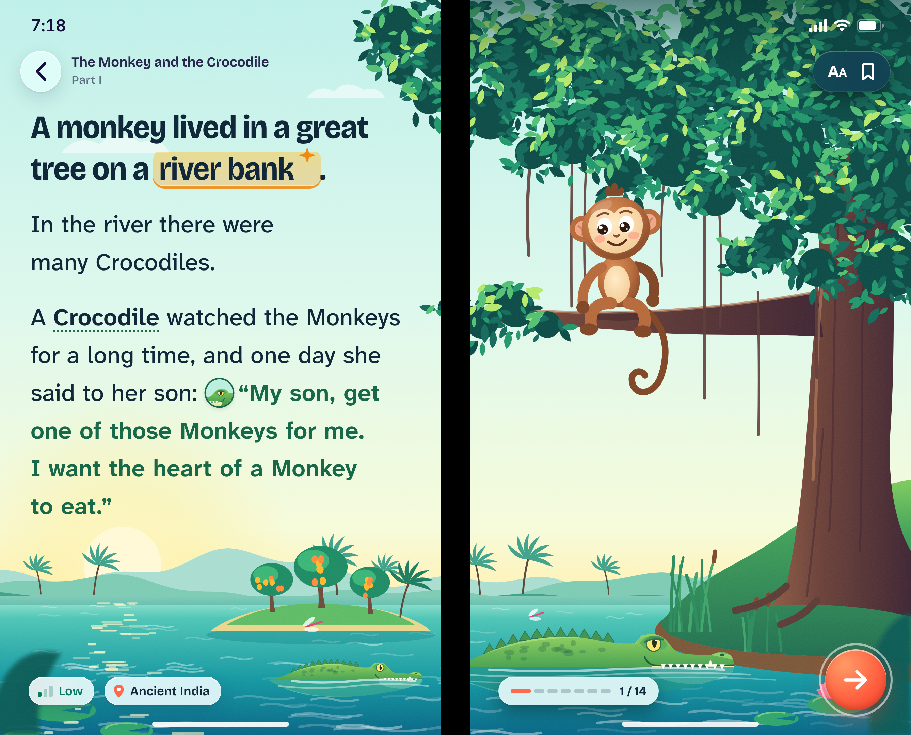

# Omramo

A magical book that you read. Omramo is a global English, illustration-driven story reader for children who can already read, built natively in Swift (SwiftUI) for the two-pane **iPhone Duo**, with a folded single-screen mode.

Sunrise Gen AI LLC · private · `omramo.com`

## What it is

- **Reading is the product.** No video, no narration, no autoplay. A page turns only when the child presses the button.
- **Three tiers:** Low, Medium, Advanced. Each story belongs to exactly one.
- **Tap-to-see:** tap a marked word and a visual opens on the facing pane; one button returns to the same line. Character cards work the same way.
- **Stories from the world's cultures**, each with its place on the map. Prototype set: a Jataka tale (ancient India), an Anansi story (Akan, Ghana), Urashima Taro (Japan).
- **For parents:** pages read, never screen time. No ads, no tracking, no data collected.
- **Free sample, then a family subscription** (StoreKit 2), with purchases behind a grown-up gate. Price: TBD.

## Status

v2 design is approved and locked (13 Nov 2026). This branch holds the planning documents. No app code yet; the first code milestone is M1 in the implementation plan.

## Documents

| Document | Contents |
|---|---|
| [`docs/PRD.md`](docs/PRD.md) | Product requirements, features and priorities, metrics, risks, open questions |
| [`docs/ARCHITECTURE.md`](docs/ARCHITECTURE.md) | Modules, Duo pane abstraction, story format, StoreKit, privacy, accessibility, testing |
| [`docs/DESIGN.md`](docs/DESIGN.md) | Design tokens, type scale, components, specs for all 12 screens |
| [`docs/IMPLEMENTATION_PLAN.md`](docs/IMPLEMENTATION_PLAN.md) | Milestones M1–M8 with acceptance criteria |
| [`docs/design/`](docs/design/) | The 12 locked screenshots |
| [`docs/PRODUCT.md`](docs/PRODUCT.md) | The earlier Telugu-first v1 lock. Superseded; kept for history |

Build instructions (`docs/BUILD.md`) arrive with M1. The Xcode project will be generated from `project.yml` with XcodeGen.

## Screens

